# Przewodnik po MojeSchronisko.pl

Ten przewodnik pokazuje krok po kroku, jak prowadzić elektroniczny rejestr zwierząt: od zalogowania, przez dodawanie zwierząt, wydarzeń i kart zdrowia, po pobieranie raportów i korzystanie z dodatków, takich jak pochodzenie zwierząt i szczepienia. Na zrzutach ekranu czerwoną ramką zaznaczono miejsce, w które należy kliknąć. Kliknij dowolny zrzut, aby go powiększyć.

## 1. Logowanie

Rejestr jest dostępny tylko dla zalogowanych pracowników schroniska. Każde schronisko widzi wyłącznie swoje zwierzęta.

### Krok 1. Otwórz stronę logowania

Wejdź na adres panelu schroniska i kliknij **Zaloguj się**. Na następnym ekranie podaj adres e-mail i hasło otrzymane od administratora.

### Krok 2. Sprawdź, czy jesteś w swoim schronisku

Po zalogowaniu otwiera się lista zwierząt. W lewym górnym rogu widzisz nazwę swojego schroniska. Kliknięcie w nią z dowolnego miejsca aplikacji zawsze wraca do listy zwierząt.

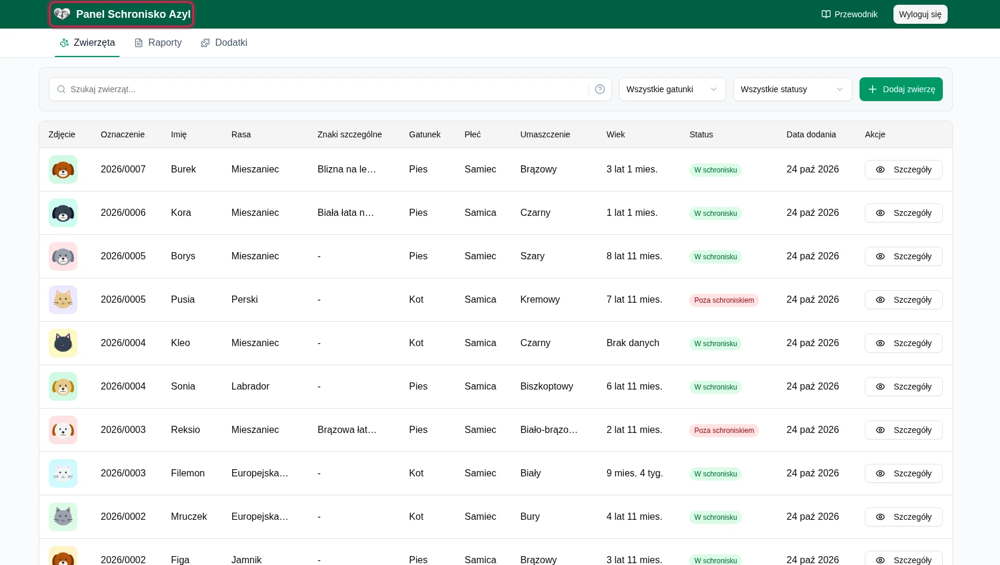

### Krok 3. Poznaj menu

Pod paskiem z nazwą schroniska jest menu z zakładkami: **Zwierzęta** (lista zwierząt), **Raporty** i **Dodatki**. Zakładka, w której jesteś, jest podświetlona. Gdy włączysz dodatek **Szczepienia**, w menu pojawi się także jego zakładka. Przycisk **Przewodnik** w prawym górnym rogu otwiera tę instrukcję.

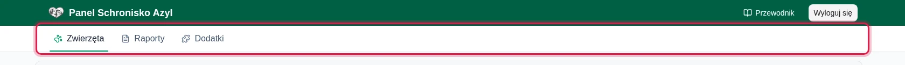

### Krok 4. Wyloguj się po zakończeniu pracy

Gdy kończysz pracę, zwłaszcza na wspólnym komputerze, kliknij **Wyloguj się** w prawym górnym rogu.

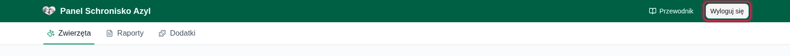

> **Wskazówka:** Jeśli po zalogowaniu widzisz komunikat „Nie masz przypisanej roli”, Twoje konto nie zostało jeszcze przypisane do schroniska. Skontaktuj się z administratorem.

## 2. Lista zwierząt

Lista zwierząt to ekran startowy panelu. Znajdziesz tu wszystkie zwierzęta wpisane do rejestru schroniska, także te, które już je opuściły.

### Krok 1. Przejrzyj listę

Każdy wiersz to jedno zwierzę: zdjęcie główne, oznaczenie, imię, rasa, znaki szczególne, gatunek, płeć, umaszczenie, wiek, status i data dodania.

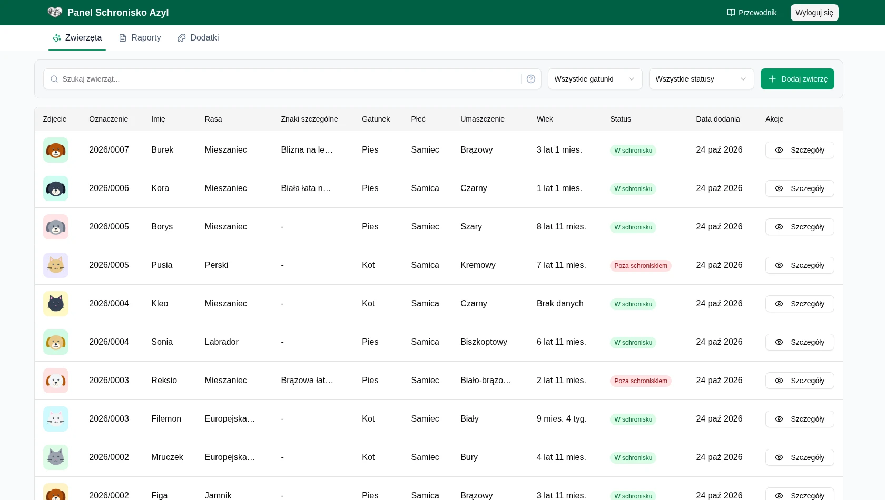

### Krok 2. Sprawdź, po czym można szukać

Kliknij ikonę informacji obok pola wyszukiwania, aby zobaczyć listę danych, po których działa wyszukiwarka: oznaczenie, numer chipa, imię, umaszczenie, rasa, znaki szczególne, a także opisy wydarzeń i osoby, które je wpisały.

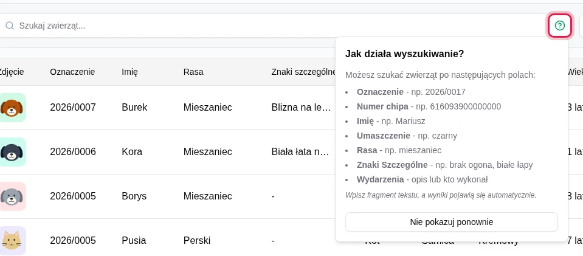

### Krok 3. Wyszukaj zwierzę

Wpisz szukany tekst w polu **Szukaj zwierząt...**. Lista odświeża się sama po chwili, nie trzeba niczego zatwierdzać. Na przykładzie wpisano rasę „mieszaniec”.

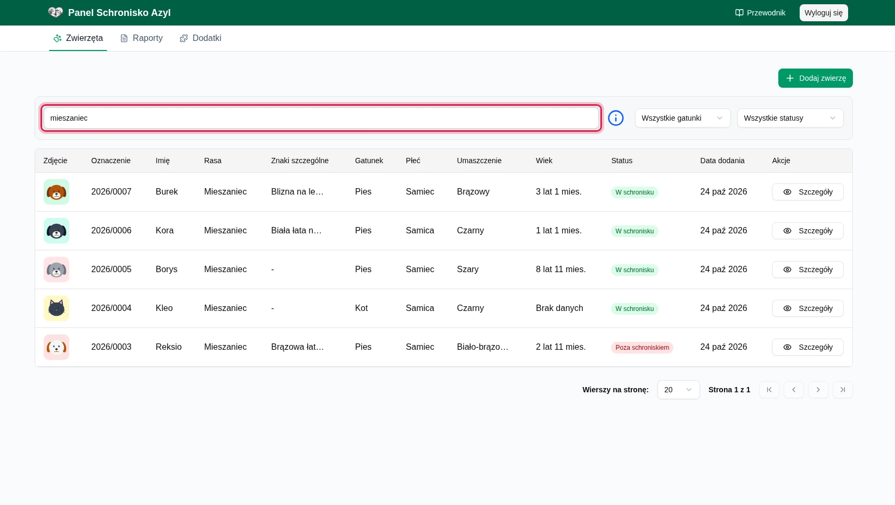

### Krok 4. Zawęź listę filtrami

Listy **Gatunek** i **Status** ograniczają tabelę do psów lub kotów oraz do zwierząt przebywających w schronisku albo poza nim. Filtry można łączyć ze sobą i z wyszukiwaniem. Aby wrócić do pełnej listy, wybierz **Wszystkie gatunki** i **Wszystkie statusy**.

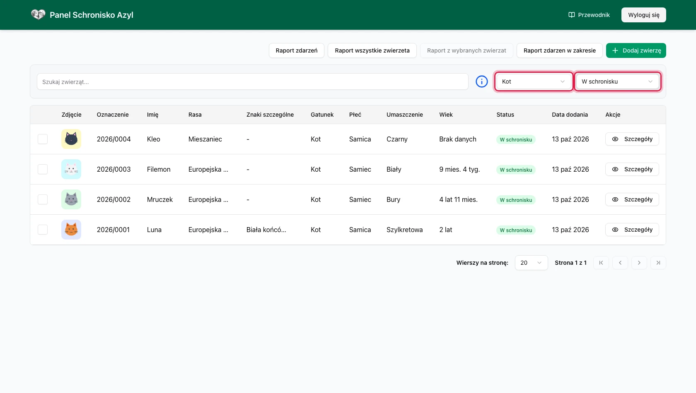

### Krok 5. Przechodź między stronami

Pod tabelą wybierasz, ile wierszy ma się mieścić na stronie (10, 20 lub 50), i przechodzisz strzałkami do następnej, poprzedniej, pierwszej lub ostatniej strony.

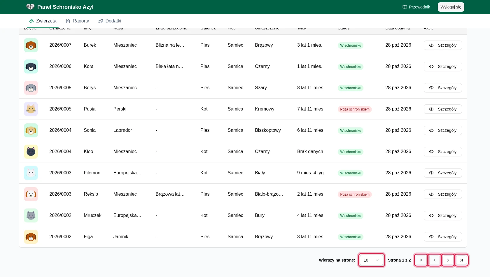

### Krok 6. Otwórz kartę zwierzęcia

Kliknij **Szczegóły** na końcu wiersza, aby otworzyć kartę wybranego zwierzęcia.

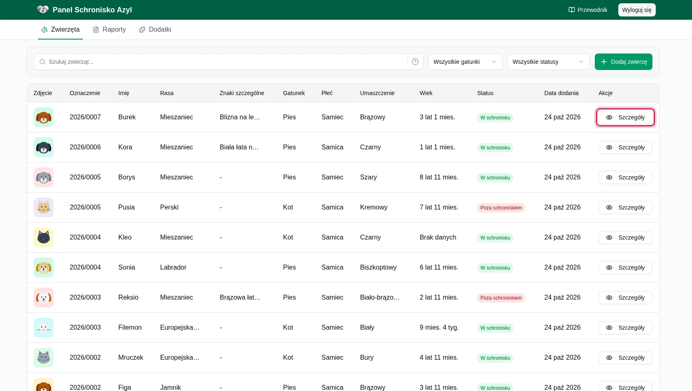

> **Wskazówka:** Adres strony zapamiętuje wyszukiwany tekst, filtry i numer strony. Możesz go skopiować i wysłać współpracownikowi, a zobaczy dokładnie tę samą listę.

## 3. Dodawanie zwierzęcia

Nowe zwierzę dodajesz jednym formularzem. Obowiązkowe są tylko **Gatunek** i **Oznaczenie**. Pozostałe dane możesz uzupełnić później.

### Krok 1. Kliknij „Dodaj zwierzę”

Przycisk **Dodaj zwierzę** znajduje się po prawej stronie paska wyszukiwania i filtrów, nad listą zwierząt.

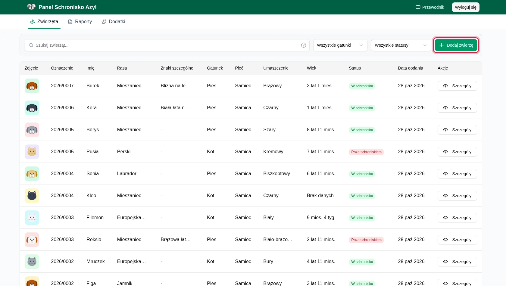

### Krok 2. Uzupełnij dane zwierzęcia

Wpisz imię, numer chipa, rasę, znaki szczególne, umaszczenie i datę urodzenia oraz wybierz gatunek i płeć. Jeśli zwierzę nie ma jeszcze imienia, zostaw to pole puste. Na liście będzie rozpoznawane po oznaczeniu.

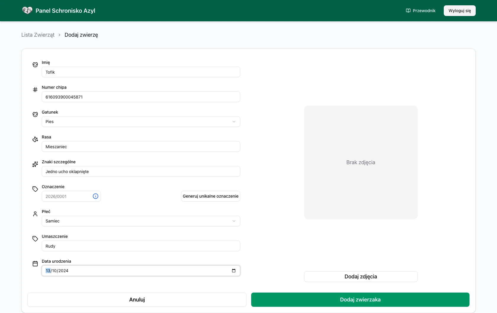

### Krok 3. Nadaj oznaczenie

Oznaczenie to numer zwierzęcia w rejestrze w formacie **RRRR/NNNN** (rok i kolejny numer). Oznaczenie można wygenerować dopiero po wybraniu gatunku: dopóki pole **Gatunek** jest puste, przycisk **Generuj unikalne oznaczenie** jest nieaktywny. Wybierz więc najpierw gatunek, a potem kliknij ten przycisk, a aplikacja podpowie pierwszy wolny numer. Możesz też wpisać oznaczenie ręcznie. Dwa zwierzęta tego samego gatunku nie mogą mieć tego samego oznaczenia.

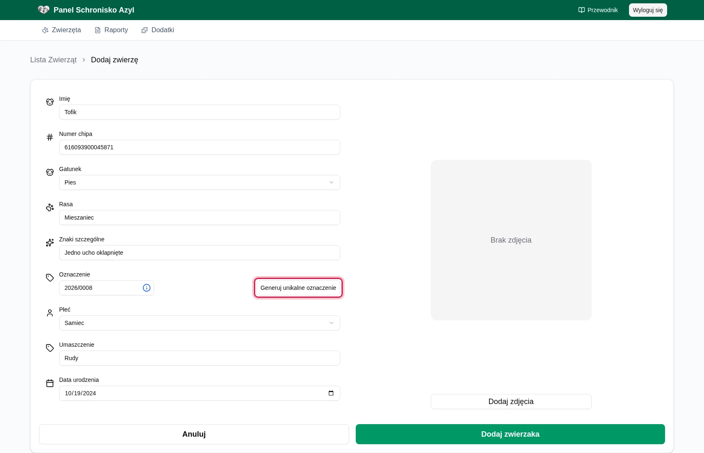

### Krok 4. Dodaj zdjęcia

Możesz dodać do 10 zdjęć, każde o rozmiarze do 10 MB. Pierwsze dodane zdjęcie staje się zdjęciem głównym, widocznym na liście zwierząt. Kliknij miniaturę, aby wybrać zdjęcie, a następnie użyj przycisków nad podglądem: **Ustaw jako główne**, **Obróć w prawo** lub **Usuń zdjęcie**.

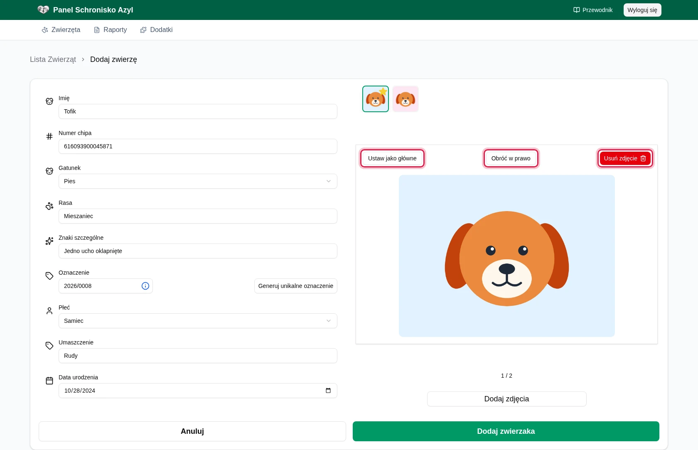

### Krok 5. Zapisz zwierzę

Kliknij **Dodaj zwierzaka**. Jeśli któreś pole jest wypełnione błędnie, pod nim pojawi się czerwony komunikat i formularz nie zostanie wysłany. Przycisk **Anuluj** wraca do listy bez zapisywania.

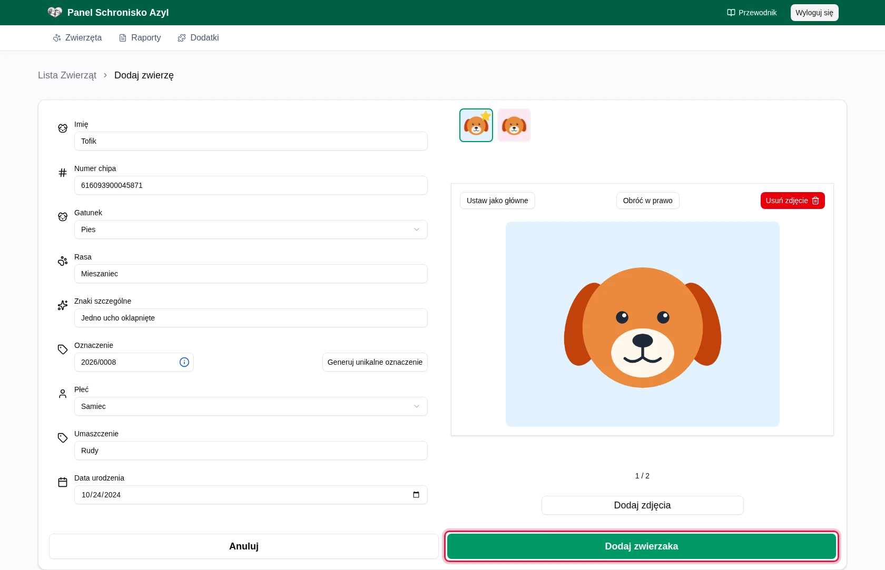

### Krok 6. Znajdź nowe zwierzę na liście

Po zapisaniu wracasz do listy zwierząt. Nowe zwierzę jest już w rejestrze ze statusem **W schronisku**.

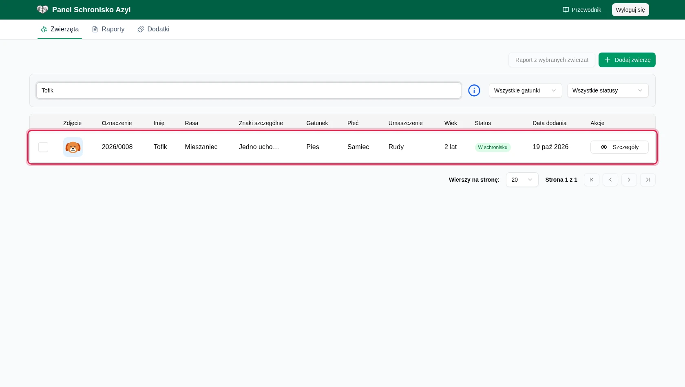

## 4. Karta zwierzęcia

Karta zbiera w jednym miejscu wszystko, co wiadomo o zwierzęciu, i prowadzi do edycji danych, wydarzeń oraz kart zdrowia.

### Krok 1. Zapoznaj się z kartą

U góry widzisz zdjęcie główne, imię, status oraz podstawowe dane: gatunek, płeć, sygnaturę (oznaczenie), umaszczenie, rasę, znaki szczególne, datę urodzenia i datę dodania. Pola bez danych są oznaczone jako „Brak”.

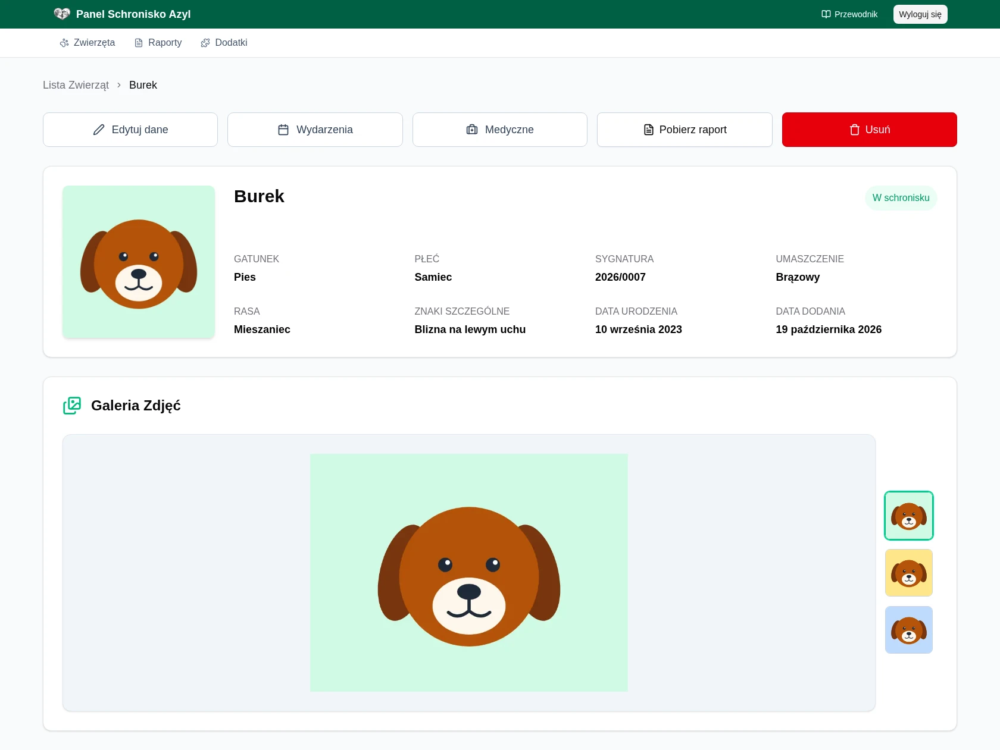

### Krok 2. Przejdź do edycji, wydarzeń lub kart zdrowia

Przyciski na karcie prowadzą do kolejnych zakładek: **Edytuj dane**, **Wydarzenia** i **Medyczne**. Ścieżka nad przyciskami („Lista Zwierząt > Burek”) pozwala wrócić do listy.

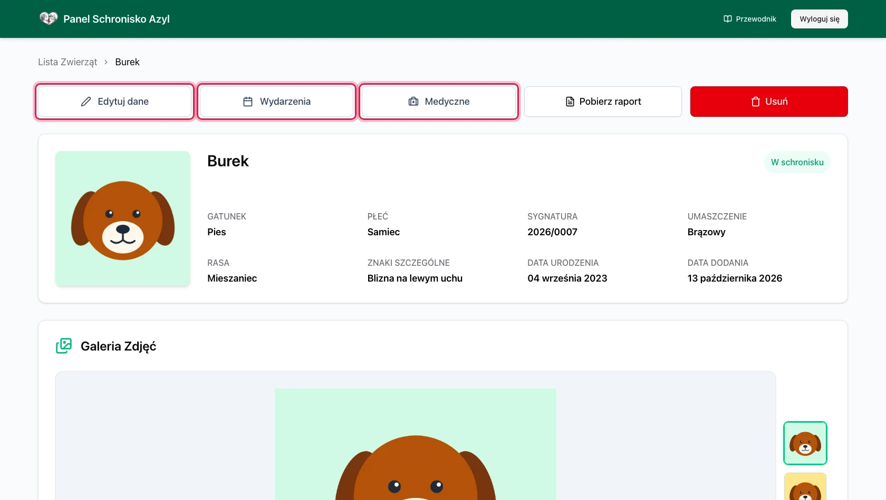

### Krok 3. Przeglądaj galerię zdjęć

W sekcji **Galeria Zdjęć** znajdziesz wszystkie zdjęcia zwierzęcia. Klikaj miniatury po prawej stronie, aby przeglądać zdjęcia po kolei. Wybrane zdjęcie pokazuje się w całości w dużym podglądzie.

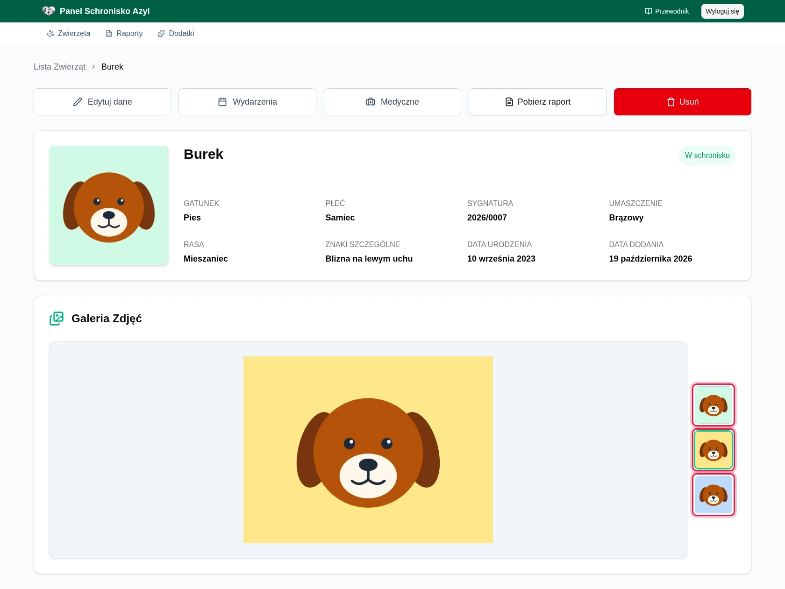

### Krok 4. Pobierz raport o zwierzęciu

Przycisk **Pobierz raport** zapisuje na komputerze plik PDF z danymi i zdjęciami tego zwierzęcia.

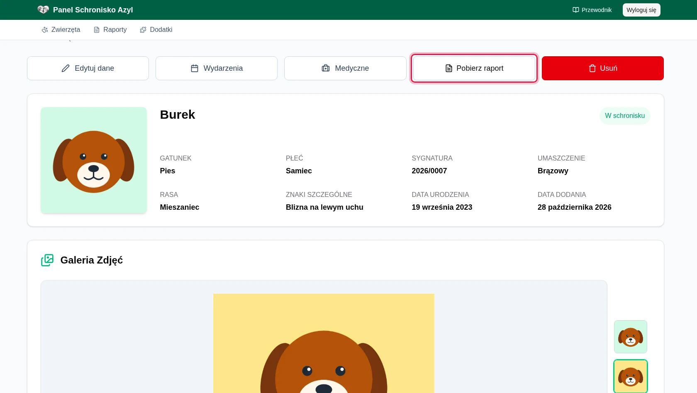

### Krok 5. Usuń zwierzę z rejestru

Przycisk **Usuń** otwiera okno z prośbą o potwierdzenie. Dopiero kliknięcie **Usuń** w tym oknie usuwa zwierzę. **Anuluj** zamyka okno bez zmian. Usunięcia nie można cofnąć, dlatego używaj go tylko dla wpisów dodanych przez pomyłkę. Gdy zwierzę opuszcza schronisko, nie usuwaj go z rejestru. Wystarczy dodać mu w zakładce **Wydarzenia** jedno z wydarzeń: **Adopcja**, **Odbiór przez właściciela**, **Wypuszczony do środowiska**, **Eutanazja** lub **Zgon**. Status zwierzęcia zmieni się wtedy na **Poza schroniskiem**, a cała jego historia zostanie w rejestrze. Jeśli zwierzę wróci, dodaj wydarzenie **Przyjęcie do schroniska**, a status wróci na **W schronisku**.

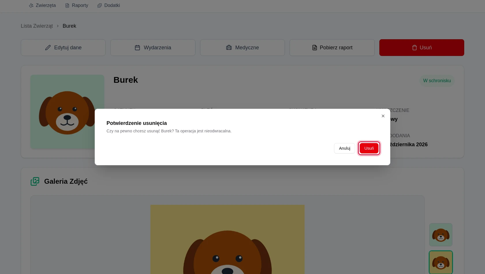

## 5. Edycja danych zwierzęcia

Dane i zdjęcia zwierzęcia można poprawić w każdej chwili. Formularz edycji wygląda tak samo jak formularz dodawania.

### Krok 1. Otwórz formularz edycji

Na karcie zwierzęcia kliknij **Edytuj dane**.

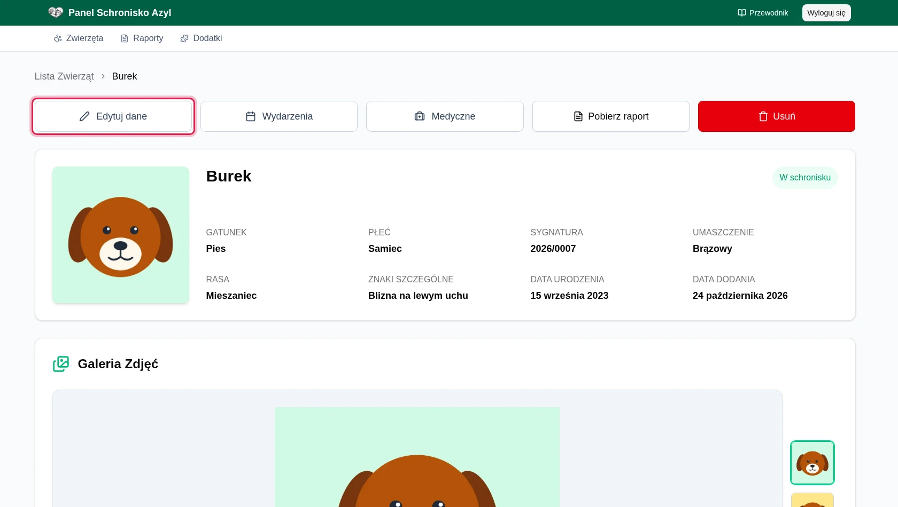

### Krok 2. Zmień dane

Formularz otwiera się z zapisanymi danymi. Popraw wybrane pola. Dane nieobowiązkowe możesz też wyczyścić.

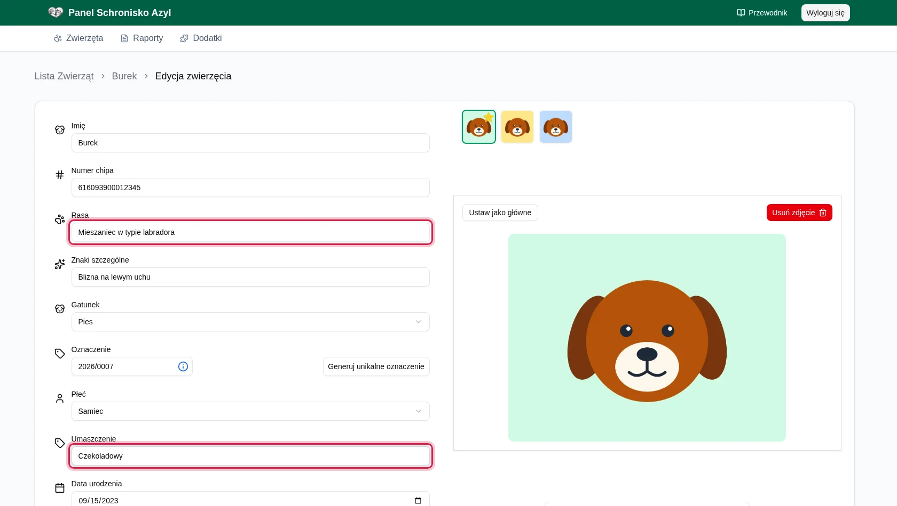

### Krok 3. Zmień zdjęcie główne

Kliknij miniaturę zdjęcia, które ma być widoczne na liście zwierząt, a potem **Ustaw jako główne**. W tym samym miejscu dodasz nowe zdjęcia, obrócisz je lub usuniesz.

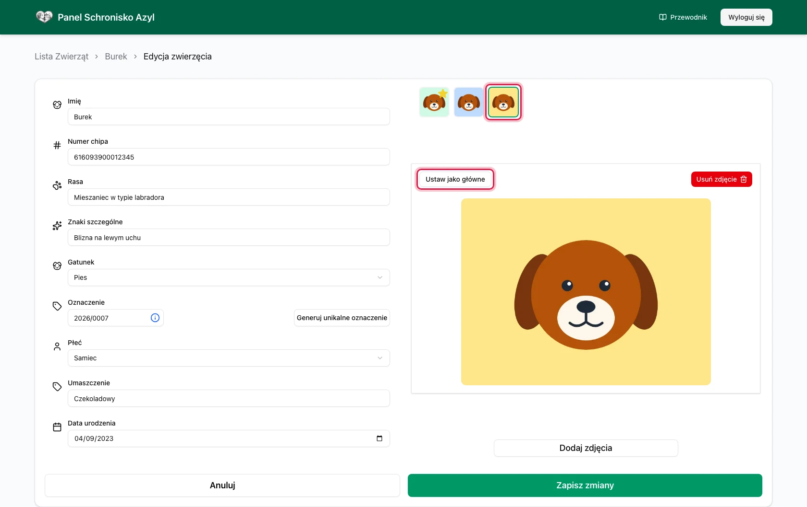

### Krok 4. Zapisz zmiany

Kliknij **Zapisz zmiany**. Przycisk jest aktywny dopiero wtedy, gdy coś faktycznie zmienisz. **Anuluj** odrzuca wprowadzone zmiany.

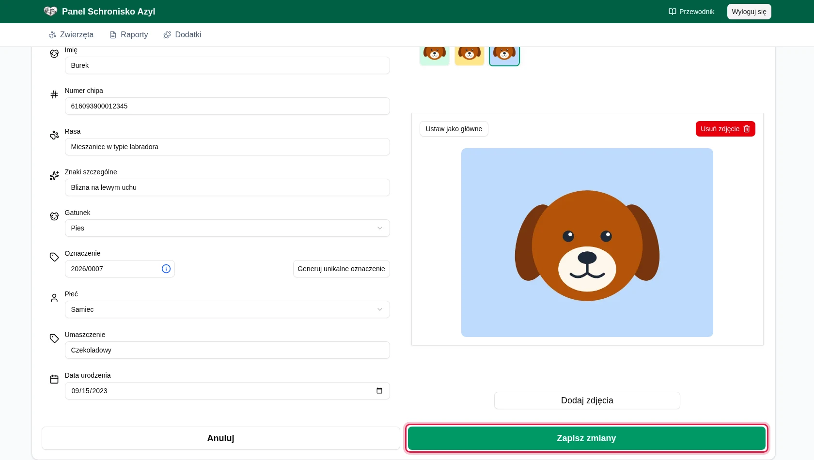

### Krok 5. Sprawdź zapisane dane

Po zapisaniu wracasz na kartę zwierzęcia z nowymi danymi i nowym zdjęciem głównym.

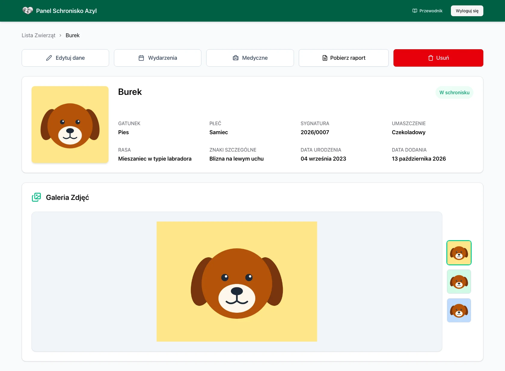

## 6. Wydarzenia

Wydarzenia to historia pobytu zwierzęcia w schronisku: przyjęcie, kwarantanna, szczepienia, odrobaczenia, spacery, ważenia, adopcja i inne. To na ich podstawie powstają raporty i ustala się status zwierzęcia.

### Krok 1. Otwórz zakładkę „Wydarzenia”

Na karcie zwierzęcia kliknij **Wydarzenia**.

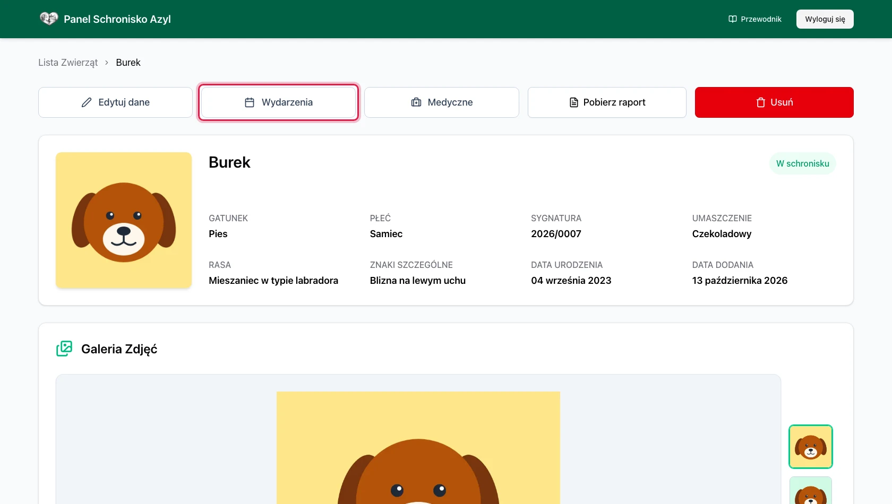

### Krok 2. Przejrzyj historię

Tabela pokazuje datę, typ i opis każdego wydarzenia oraz osobę, która je wpisała (**Wykonane przez**). Kliknięcie nagłówka ze strzałkami sortuje tabelę po tej kolumnie, a kolejne kliknięcie odwraca kolejność.

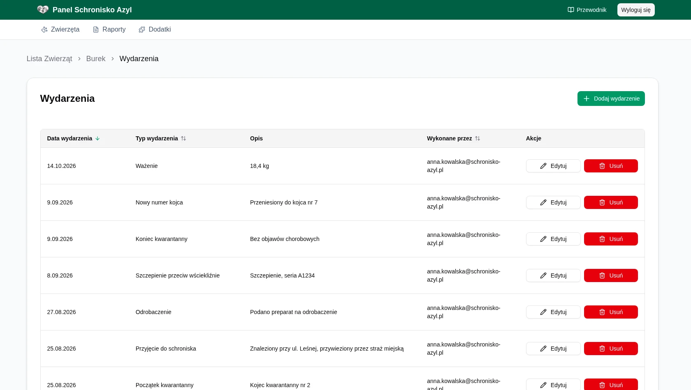

### Krok 3. Dodaj wydarzenie

Kliknij **Dodaj wydarzenie**, wybierz **Typ wydarzenia**, ustaw datę (domyślnie dzisiejsza, nie może być z przyszłości) i wpisz opis. Wszystkie trzy pola są wymagane. Zatwierdź przyciskiem **Zapisz**.

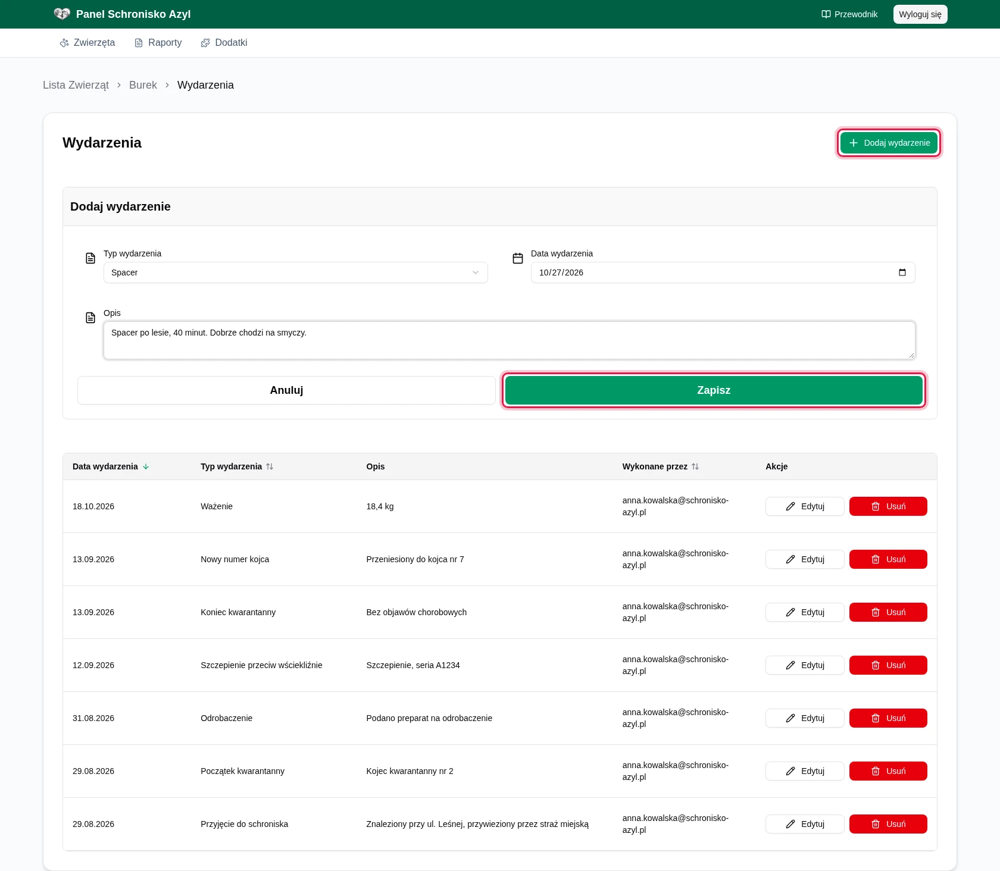

### Krok 4. Sprawdź nowy wpis

Nowe wydarzenie pojawia się w tabeli. W kolumnie **Wykonane przez** aplikacja sama wpisuje zalogowaną osobę.

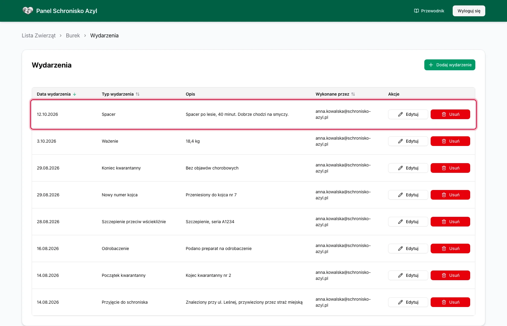

### Krok 5. Popraw wydarzenie

Kliknij **Edytuj** w wierszu wydarzenia. Typ, data i opis zamieniają się w pola, które możesz poprawić bezpośrednio w tabeli. Zatwierdź przyciskiem **Zapisz** albo wycofaj się przyciskiem **Anuluj**. Jednocześnie można edytować tylko jeden wiersz.

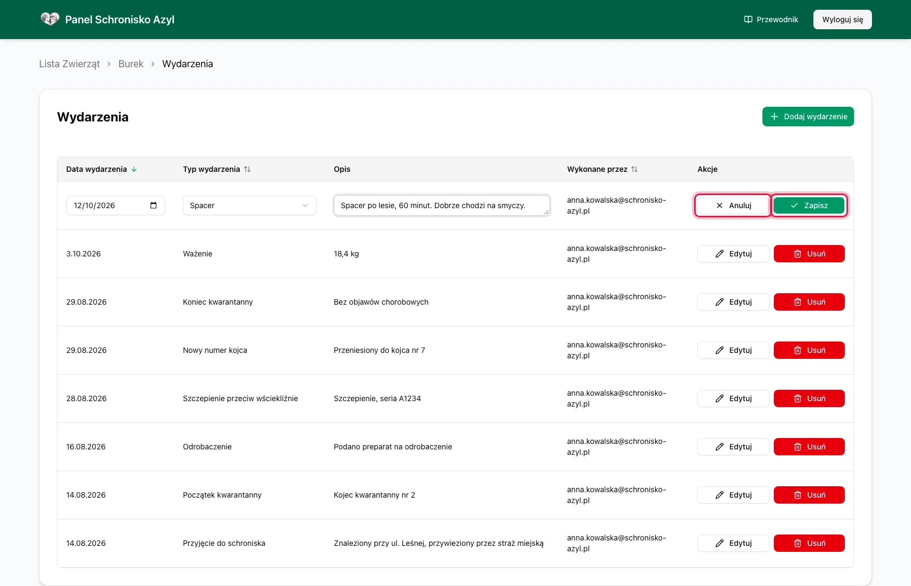

### Krok 6. Usuń błędne wydarzenie

Kliknij **Usuń** w wierszu, a następnie potwierdź w oknie, które się pojawi. **Anuluj** zostawia wydarzenie bez zmian.

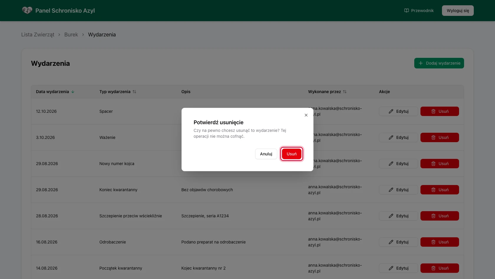

> **Wskazówka:** Wydarzenia takie jak **Adopcja** czy **Odbiór przez właściciela** zmieniają status zwierzęcia na **Poza schroniskiem**. Nie usuwaj wtedy zwierzęcia z rejestru, wystarczy dodać właściwe wydarzenie.

## 7. Karty zdrowia

W kartach zdrowia zapisujesz badania, zabiegi i zalecenia weterynaryjne. Do każdego wpisu możesz dołączyć dokument, na przykład wynik badania.

### Krok 1. Otwórz zakładkę „Medyczne”

Na karcie zwierzęcia kliknij **Medyczne**.

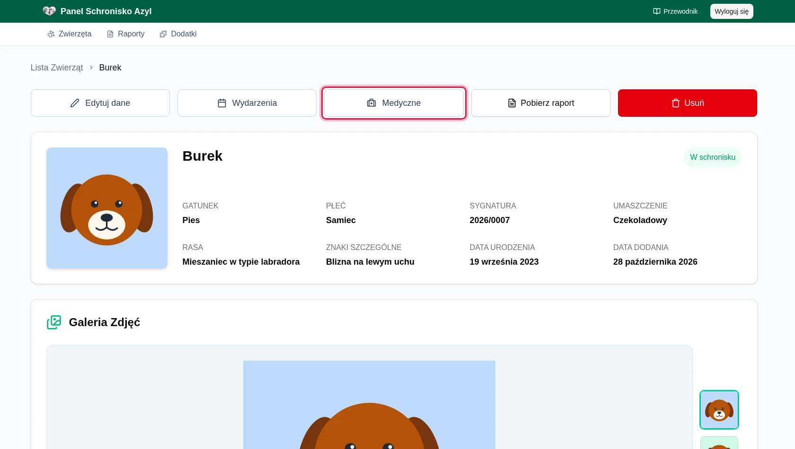

### Krok 2. Dodaj kartę zdrowia

Kliknij **Dodaj kartę zdrowia**, ustaw datę i wpisz opis. W polu **Dokument (opcjonalnie)** możesz dołączyć jeden plik PDF, DOC, DOCX, JPEG, PNG lub WEBP o rozmiarze do 10 MB. Zatwierdź przyciskiem **Zapisz**.

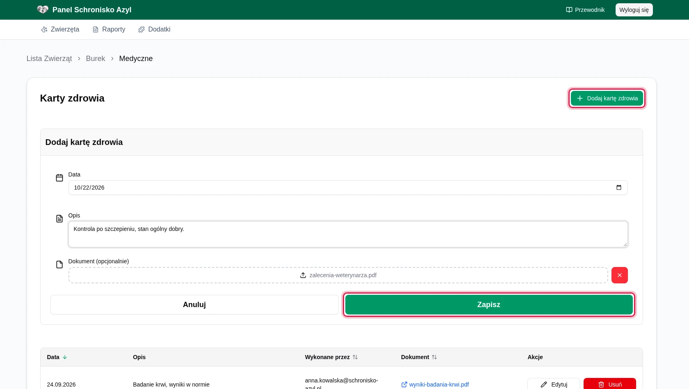

### Krok 3. Otwórz dołączony dokument

Wpis pojawia się w tabeli. Kliknij nazwę pliku w kolumnie **Dokument**, aby otworzyć go w nowej karcie przeglądarki.

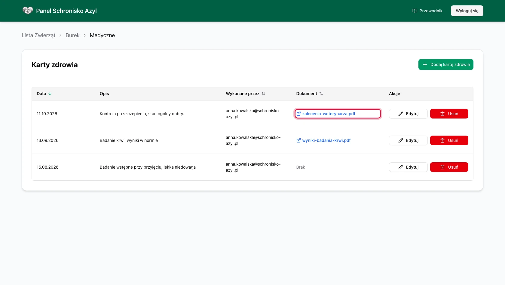

### Krok 4. Popraw wpis lub wymień dokument

Kliknij **Edytuj** w wierszu. Możesz zmienić datę i opis, a w kolumnie **Dokument** wymienić plik (**Zmień plik**) lub go usunąć (**Usuń**). Zatwierdź przyciskiem **Zapisz**. Cały wpis usuwasz przyciskiem **Usuń**, po potwierdzeniu.

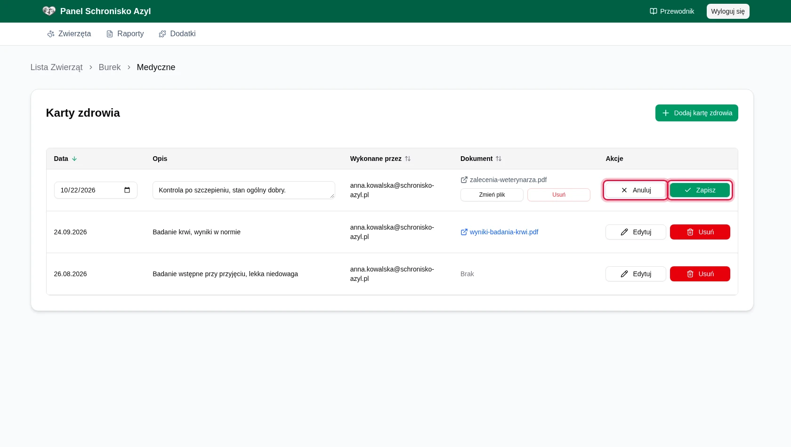

## 8. Raporty

Wszystkie raporty pobierają się jako pliki PDF gotowe do druku. Znajdziesz je w zakładce **Raporty**, podzielone na grupy.

### Krok 1. Otwórz zakładkę Raporty

Kliknij **Raporty** w menu. U góry strony wybierasz grupę raportów: **Zwierzęta** albo **Zdarzenia**. Po włączeniu dodatków pojawiają się kolejne grupy. Wybrana grupa zostaje zapamiętana w adresie strony.

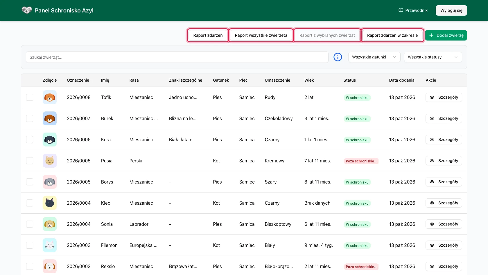

### Krok 2. Pobierz raport wszystkich zwierząt

W grupie **Zwierzęta**, w karcie **Wszystkie zwierzęta**, kliknij **Generuj raport**, aby pobrać tekstowe zestawienie danych wszystkich zwierząt z rejestru (bez zdjęć). Plik zapisuje się od razu, bez dodatkowych pytań.

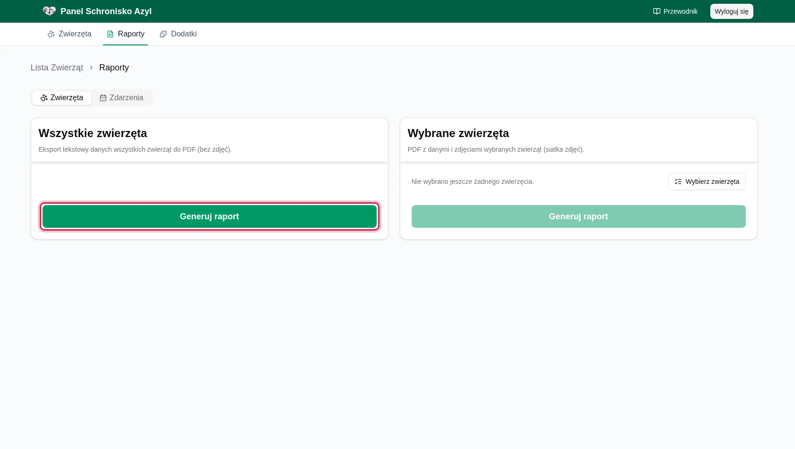

### Krok 3. Wybierz zwierzęta do raportu

Raport **Wybrane zwierzęta** zawiera dane i zdjęcia tylko tych zwierząt, które wskażesz. Kliknij **Wybierz zwierzęta**. W oknie zaznacz zwierzęta na liście albo wyszukaj je po imieniu lub sygnaturze. Zaznaczenie zostaje przy zmianie strony i wyszukiwaniu, a liczbę wybranych widzisz na dole. Kliknij **Gotowe**.

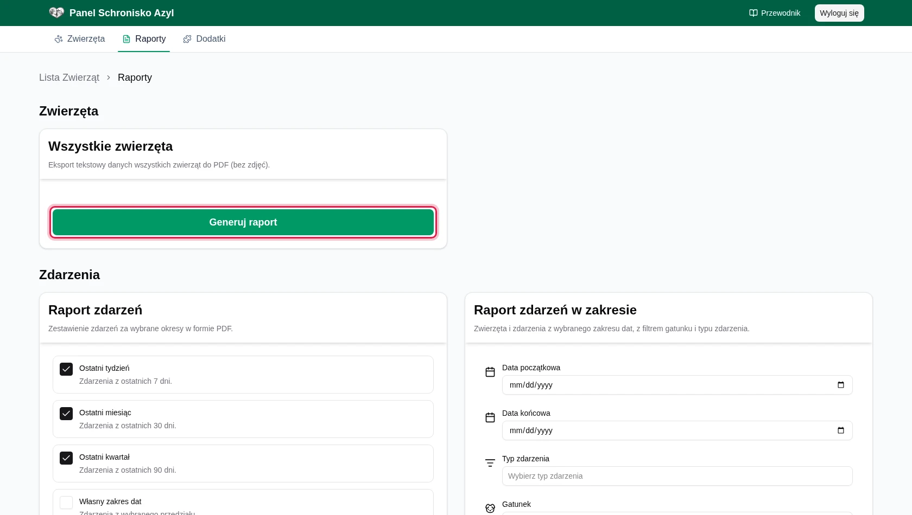

### Krok 4. Pobierz raport wybranych zwierząt

Karta pokazuje, ile i które zwierzęta wybrałeś. Kliknij **Generuj raport**, aby pobrać PDF. Wybór możesz poprawić przyciskiem **Zmień wybór**.

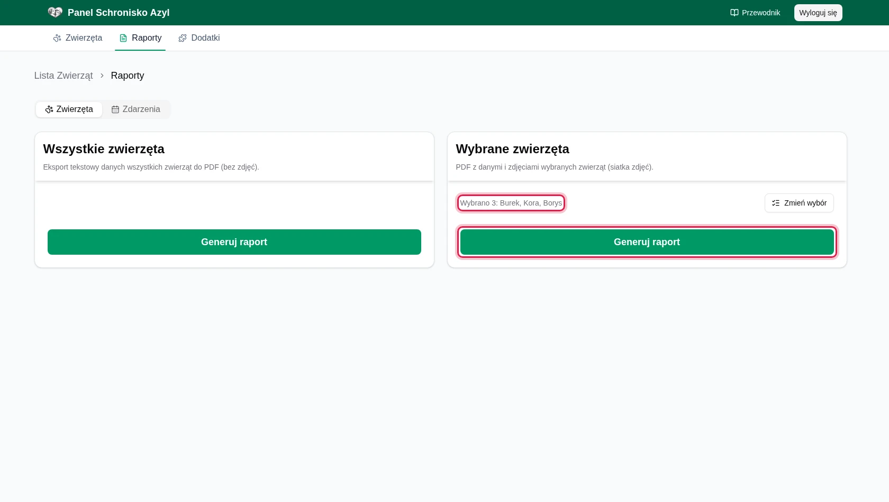

### Krok 5. Wygeneruj raport zdarzeń

Przejdź do grupy **Zdarzenia**. W karcie **Raport zdarzeń** zaznacz okresy, które mają się znaleźć w zestawieniu: ostatni tydzień, miesiąc, kwartał lub **Własny zakres dat**. Przy własnym zakresie podaj datę początkową i końcową. Kliknij **Generuj raport**.

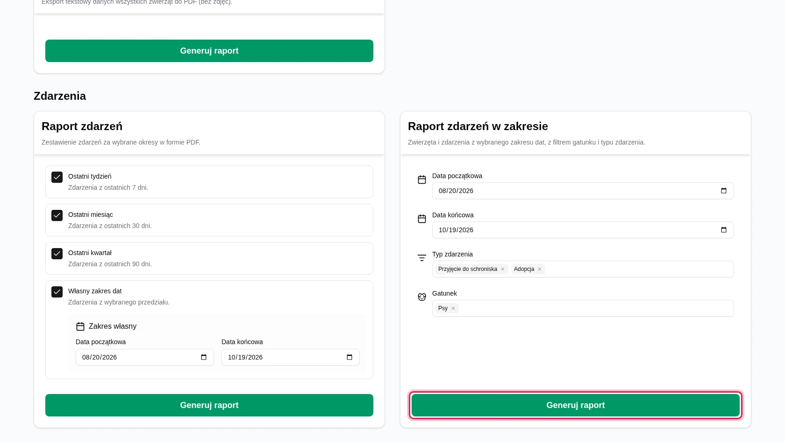

### Krok 6. Wygeneruj raport zdarzeń w zakresie dat

W karcie **Raport zdarzeń w zakresie** podaj datę początkową oraz końcową. Opcjonalnie zawęź raport do wybranych typów zdarzeń i gatunków. Puste pola oznaczają „wszystkie”. Kliknij **Generuj raport**.

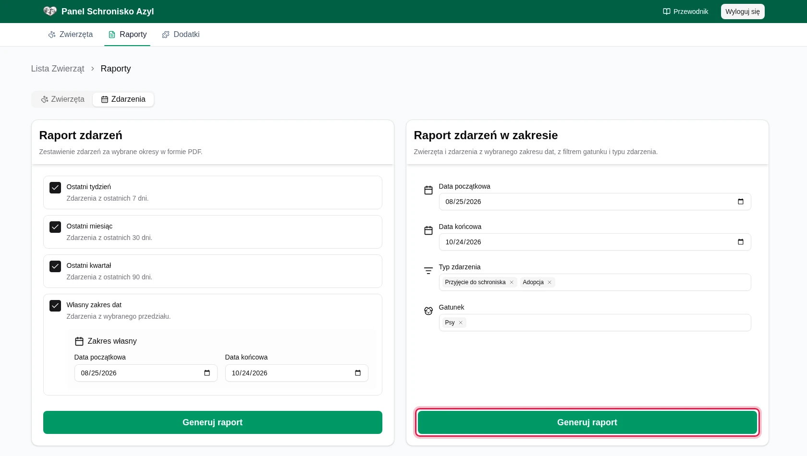

> **Wskazówka:** Pobrane raporty znajdziesz w folderze pobierania swojej przeglądarki, zwykle „Pobrane”.

## 9. Dodatki

Dodatki to dodatkowe funkcje rejestru, które włączasz tylko wtedy, gdy ich potrzebujesz. Dodatek zmienia się dla całego schroniska: włączony jest widoczny dla wszystkich pracowników.

### Krok 1. Otwórz listę dodatków

Kliknij zakładkę **Dodatki** w menu. Każdy dodatek to osobna karta z krótkim opisem i oznaczeniem **Włączony** lub **Wyłączony**. Kliknij kartę, aby zobaczyć szczegóły.

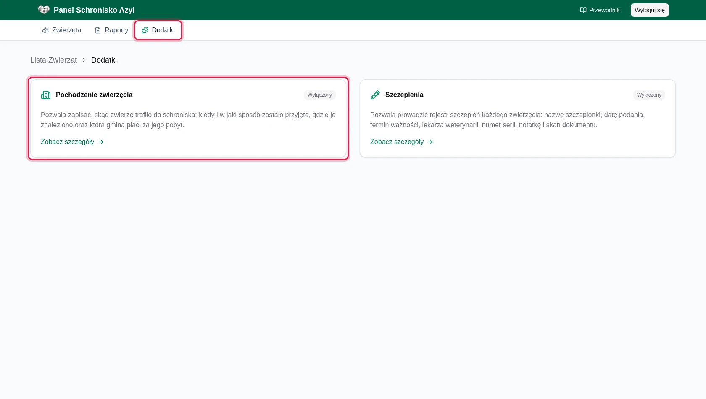

### Krok 2. Włącz dodatek

Na stronie dodatku przeczytasz, co dokładnie robi. Administrator schroniska włącza go przyciskiem **Włącz dodatek**, a wyłącza przyciskiem **Wyłącz dodatek**. Dane wpisane w dodatku nie znikają po jego wyłączeniu.

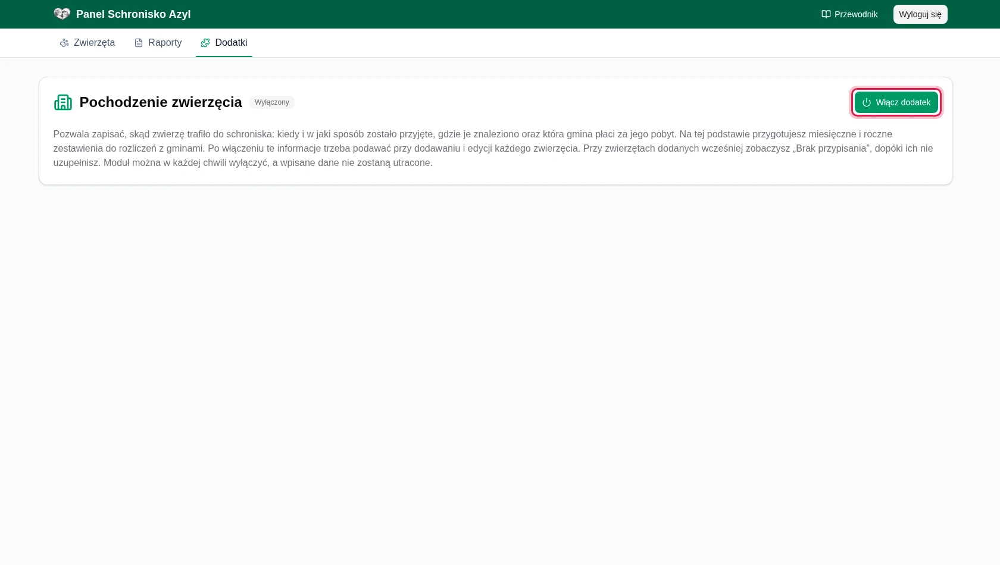

### Krok 3. Sprawdź, czy dodatek jest włączony

Po włączeniu przy nazwie dodatku widzisz oznaczenie **Włączony**, a pod opisem pojawia się część do pracy z dodatkiem. Tutaj jest to lista gmin.

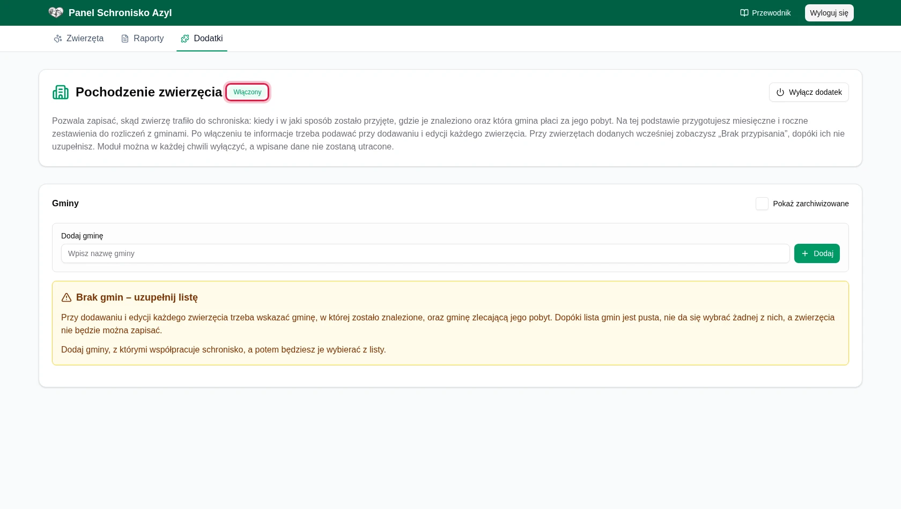

### Krok 4. Włącz także szczepienia

Dodatek **Szczepienia** włączasz tak samo. Dodatki, z których korzystasz codziennie, mają własną zakładkę w menu. Po włączeniu szczepień zobaczysz tam nową zakładkę **Szczepienia**.

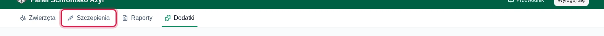

> **Wskazówka:** Dodatki włącza i wyłącza tylko administrator schroniska. Pozostali pracownicy widzą listę dodatków i ich opisy, ale nie mają przycisku włączania. Jeśli potrzebujesz dodatku, poproś o jego włączenie administratora.

## 10. Pochodzenie zwierzęcia

Dodatek **Pochodzenie zwierzęcia** zapisuje, skąd i w jaki sposób zwierzę trafiło do schroniska oraz która gmina płaci za jego pobyt. Na tej podstawie przygotujesz miesięczne i roczne zestawienia do rozliczeń z gminami.

### Krok 1. Najpierw uzupełnij listę gmin

Zanim dodasz lub zmienisz zwierzę, na liście muszą być gminy. Dopóki jest pusta, formularza zwierzęcia nie da się zapisać. Gminy dodajesz w polu **Dodaj gminę** nad listą.

### Krok 2. Dodaj gminy

Wpisz nazwę gminy i kliknij **Dodaj** albo naciśnij Enter. Pod polem pojawi się potwierdzenie, a pole zostanie wyczyszczone, więc od razu możesz wpisać kolejną gminę, z którą współpracuje schronisko.

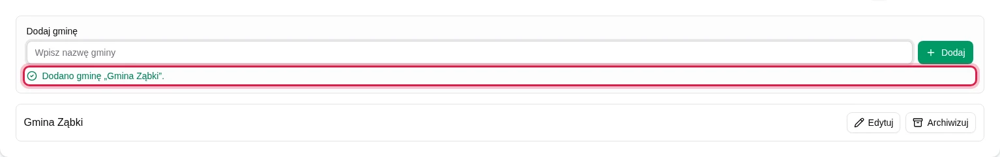

### Krok 3. Zarządzaj listą gmin

Gminy są ułożone alfabetycznie. Każdą możesz zmienić przyciskiem **Edytuj** lub schować przyciskiem **Archiwizuj**. Zarchiwizowanej gminy nie da się wybrać w formularzu, ale zwierzęta, które jej dotyczą, zachowują wpis. Zaznacz **Pokaż zarchiwizowane**, aby ją zobaczyć i przywrócić. Nazwy zarchiwizowanej gminy nie da się użyć dla nowej ani zmienionej gminy, więc zamiast zakładać ją od nowa, przywróć ją.

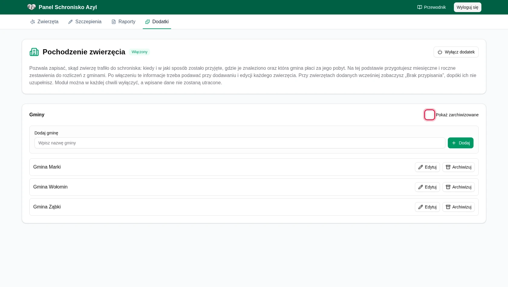

### Krok 4. Uzupełnij pochodzenie zwierzęcia

W formularzu dodawania i edycji pojawia się sekcja **Pochodzenie zwierzęcia**. Wpisz datę i sposób przyjęcia, miejsce znalezienia oraz wybierz **Gminę znalezienia** i **Gminę zlecającą**, czyli tę, która płaci za pobyt zwierzęcia. Wszystkie pola są wymagane.

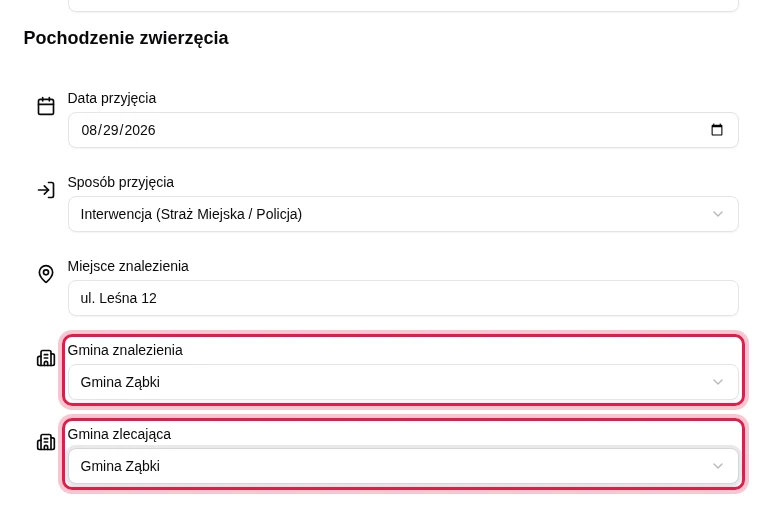

### Krok 5. Sprawdź pochodzenie na karcie zwierzęcia

Zapisane dane widać na karcie zwierzęcia w sekcji **Pochodzenie**. U zwierząt dodanych przed włączeniem dodatku zobaczysz napis **Brak przypisania**, dopóki ich nie uzupełnisz.

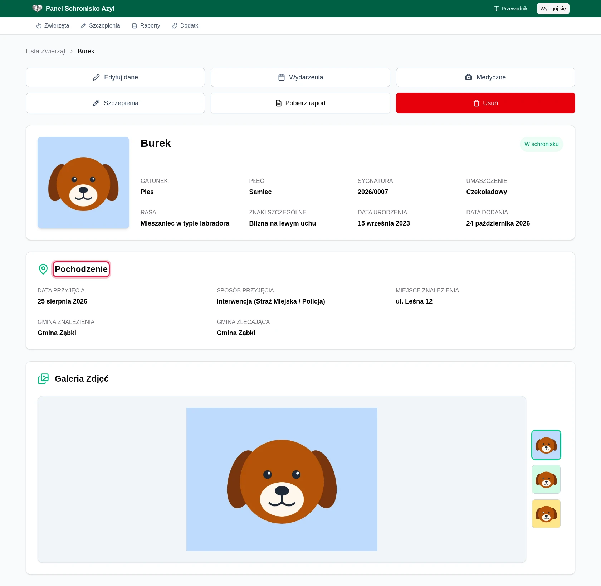

### Krok 6. Pobierz zestawienia dla gmin

W zakładce **Raporty** pojawia się grupa **Pochodzenie**. **Zestawienie miesięczne** pokazuje zwierzęta przyjęte w wybranym miesiącu, pogrupowane według gminy zlecającej, a **Zestawienie roczne** liczbę przyjętych zwierząt w każdym miesiącu. Wybierz miesiąc lub rok i kliknij **Generuj raport**.

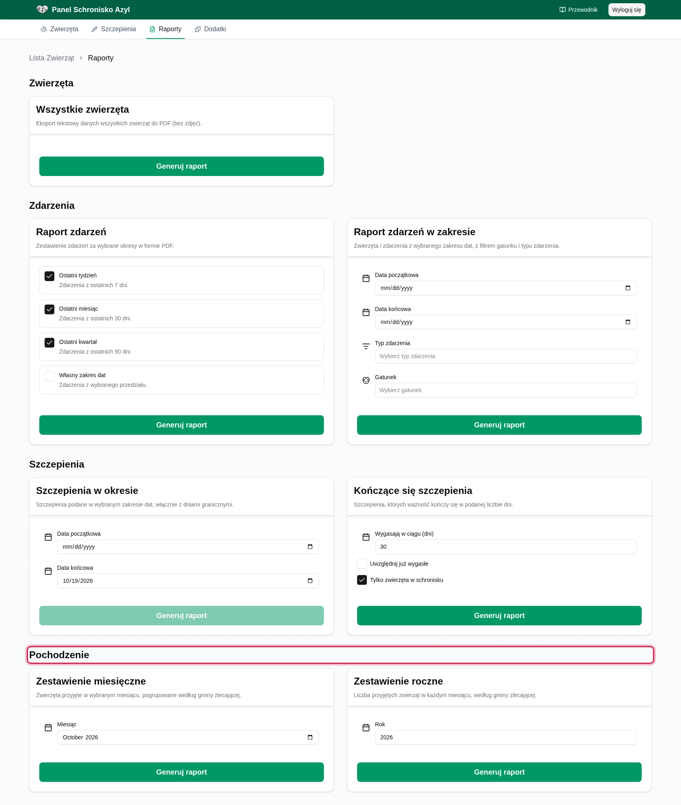

## 11. Szczepienia

Dodatek **Szczepienia** prowadzi rejestr szczepień każdego zwierzęcia: nazwę szczepionki, datę podania, termin ważności, lekarza, numer serii, notatkę i skan dokumentu. Pokazuje też, którym zwierzętom szczepienie niedługo się kończy.

### Krok 1. Otwórz zakładkę „Szczepienia”

Na karcie zwierzęcia kliknij **Szczepienia**. Przycisk jest widoczny tylko wtedy, gdy dodatek jest włączony.

### Krok 2. Dodaj szczepienie

Kliknij **Dodaj szczepienie**. Obowiązkowe są tylko nazwa szczepionki i data podania. Termin ważności (**Ważne do**) ustawisz jednym kliknięciem: **6 miesięcy**, **1 rok** albo **2 lata** od daty podania, albo wybierzesz datę ręcznie. Możesz też wpisać lekarza, numer serii, notatkę i dołączyć skan dokumentu: PDF, DOC, DOCX lub zdjęcie do 10 MB. Zatwierdź przyciskiem **Zapisz**.

### Krok 3. Sprawdź status szczepienia

Przy każdym szczepieniu widzisz status: **Ważne**, **Wygasa za N dni** (gdy do końca ważności zostało 30 dni lub mniej), **Wygasło** albo **Bez terminu ważności**. Kliknięcie nazwy pliku otwiera dołączony skan.

### Krok 4. Odnów szczepienie

Gdy szczepienie trzeba powtórzyć, kliknij **Odnów**. Okno otwiera się z tą samą szczepionką, a pole **Zastępuje szczepienie** jest już ustawione na poprzednie szczepienie. Wpisz nową datę podania i termin ważności, a następnie zapisz.

### Krok 5. Zobacz zastąpione szczepienie

Poprzednie szczepienie dostaje status **Zastąpione nowszym** i przestaje być wskazywane jako kończące się. Przy obu wpisach widzisz, które szczepienie zastępuje, a które je zastąpiło. Szczepienie, które zostało już zastąpione, nie ma przycisku **Odnów**.

### Krok 6. Sprawdź terminy szczepień

Zakładka **Szczepienia** w menu otwiera listę szczepień wszystkich zwierząt, od najbliższego terminu ważności. Domyślnie widzisz wszystkie szczepienia, także te bez terminu. Lista **Ważność** zawęża je do **Wygasających** albo **Przeterminowanych**. Przy **Wygasających** pole **Wygasają w ciągu** ustawia okres (domyślnie miesiąc, albo **wybór dni**, aby wpisać dowolną liczbę dni). Pod tabelą zmieniasz liczbę wierszy na stronę i przechodzisz między stronami. Przycisk **Szczegóły** otwiera szczepienia zwierzęcia.

### Krok 7. Dodaj szczepienie bez wchodzenia na kartę zwierzęcia

Szczepienie dodasz też prosto z listy **Szczepienia**: kliknij **Dodaj szczepienie** i w polu **Zwierzę** wyszukaj zwierzę po imieniu lub sygnaturze. Dalej wypełniasz formularz tak samo jak na karcie zwierzęcia.

### Krok 8. Pobierz raporty szczepień

W zakładce **Raporty** pojawia się grupa **Szczepienia** z dwoma raportami: **Szczepienia w okresie** (podane szczepienia w wybranym zakresie dat) i **Kończące się szczepienia** (te, których ważność kończy się w podanej liczbie dni). Kliknij **Generuj raport**, aby pobrać PDF.

> **Wskazówka:** Szczepienie możesz też poprawić przyciskiem **Edytuj** lub usunąć przyciskiem **Usuń**. Po usunięciu szczepienia, które zastąpiło inne, poprzednie znów jest traktowane jako ważne albo wygasłe.
